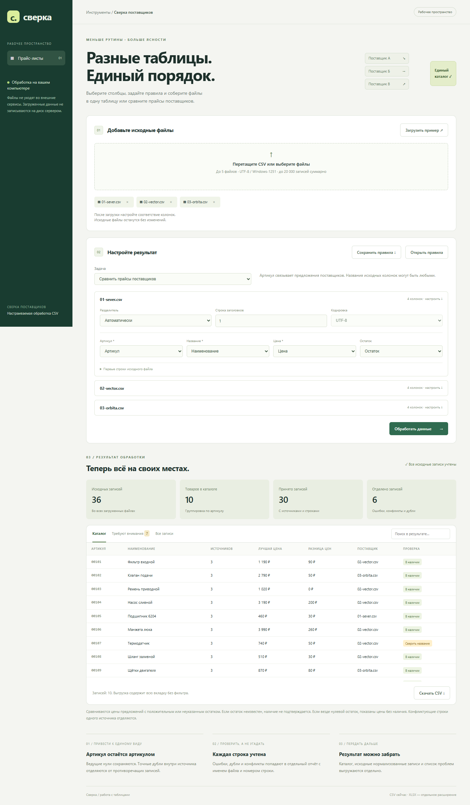

# Сверка — обработка таблиц и сравнение прайсов

Pet-проект для портфолио. Примеры поставщиков и данные вымышлены.



## Возможности

Два режима обработки:

- **Прайсы:** сопоставить артикул, название, цену и при наличии остаток; сравнить цены поставщиков; отделить ошибки, дубли и противоречащие строки.
- **Сбор таблиц:** задать до 20 своих столбцов, их типы и обязательность; сопоставить поля каждого источника; собрать строки файлов в одну таблицу. По желанию убрать полные совпадения.

Для каждого файла настраиваются разделитель, строка заголовков и соответствие колонок. Поддержаны CSV в UTF-8 и Windows-1251, разделители `;`, `,`, табуляция и `|`. Файлы с неверным UTF-8 предлагаются в Windows-1251; выбранную кодировку видно в настройках и можно изменить. Допускается до 5 файлов, до 600 КБ каждый, суммарно до 20 000 непустых записей. Исходные файлы не изменяются и не сохраняются на сервере.

Настройки можно выгрузить в JSON и открыть при следующей загрузке файлов с теми же именами. JSON содержит только правила, без содержимого таблиц.

## Как использовать

После запуска откройте http://127.0.0.1:8765.

1. Загрузите свои CSV или нажмите «Загрузить пример».
2. Выберите задачу: сравнение прайсов или сбор таблиц.
3. Если нужен свой набор полей, задайте названия столбцов и нажмите «Применить столбцы». Для кодов и артикулов выбирайте тип «Текст», чтобы сохранить нули.
4. У каждого источника укажите, в какой колонке находится нужное поле. Посмотрите первые строки; при необходимости исправьте разделитель и строку заголовка.
5. Запустите обработку, проверьте отделённые записи и скачайте результат.

Например, `Номенклатура`, `SKU` и `Код товара` могут стать единым полем «Артикул». В обычной таблице можно объединить `client_name` и `Клиент` в поле «Заказчик», а `total` и `Стоимость` — в поле «Сумма».

## Пример с произвольными столбцами

Загрузите оба файла из `examples/custom/`, затем через «Открыть правила» выберите находящийся рядом `table-rules.json`. Первый файл использует `|` и заголовок на второй строке, второй — `;` и Windows-1251. Результат содержит Код, Описание, Сумма и Город.

## Правила прайсов

Артикулы сравниваются точно после удаления внешних пробелов; регистр и ведущие нули сохраняются. Цены рассчитываются через Decimal; допускается до двух знаков после запятой. Точные повторы внутри источника отделяются, разные значения одного артикула в одном источнике признаются конфликтом и исключаются из сравнения.

Нулевой остаток исключает предложение из сравнения, если есть предложения с положительным или неизвестным остатком. Неуказанный остаток означает неизвестное наличие, а не подтверждённое. Если все остатки нулевые, цены показываются с отметкой отсутствия наличия. Разные названия одного артикула помечаются для проверки.

## Результат

Каталог, нормализованные строки и проблемы выгружаются отдельно. При сборе обычных таблиц столбцы `__source` и `__line` сохраняют источник. В цене-режиме баланс: исходные записи = принятые + ошибки + дубли + конфликтующие. При сборе таблиц конфликтующие по ключу строки не определяются: здесь выполняется добавление строк, а не JOIN.

Экспорт содержит все записи выбранной вкладки независимо от поиска и лимита предпросмотра 300 строк. Потенциальные формулы в CSV экранируются, в том числе в заголовках. Примеры результата находятся в `example-results/`.

## Структура

```text
app.py                 HTTP API
table_io.py            чтение CSV, заголовки, сопоставление и схема
reconciliation.py      проверка данных, сравнение, сбор и экспорт
local_server.py        локальный сервер
web/                   интерфейс
examples/              входные CSV
example-results/       образцы результата
tests/                 проверки правил и граничных случаев
```

XLSX, PDF, нечёткое сопоставление товаров и связывание таблиц по ключу не реализованы. XLSX можно предварительно сохранить как CSV. Валюты, НДС и экономия закупок не рассчитываются.

## Разработка

Требуется Python 3.10+. Сторонних зависимостей для запуска нет.

```text
python app.py
python -m unittest discover -s tests -v
```

На Windows можно запустить `START.cmd` или использовать `py -3` вместо `python`. Остановка сервера — Ctrl+C. Для другого порта: `python app.py --port 8780`.

HTTP-сервер слушает только `127.0.0.1`. Приложение рассчитано на локальный запуск.

В `.github/workflows/tests.yml` настроен запуск тестов на Python 3.10 и 3.12. Результаты локальных проверок — в [TESTING.md](TESTING.md).

Лицензия MIT.
